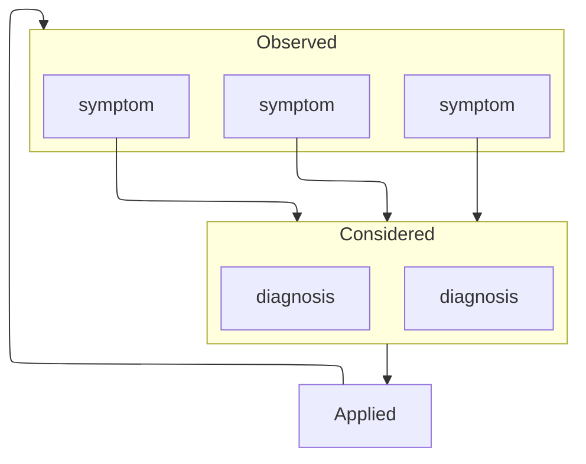

# Agent Diagnostic Manual

A database of symptoms, diagnoses and interventions for agents. Intended for discovering and addressing common problems with all types of AI agents.

The ADM is loosely modeled after the [DSM (Diagnostic and Statistical Manual of Mental Disorders)](https://www.psychiatry.org/psychiatrists/practice/dsm/), which is the standard resource for diagnosing patients in psychotherapy and mental health. 

The ADM documents a broad array of symptoms with definitions and clear instructions for discovering if an agent is exhibiting a symptom. From there, multiple diagnoses are considered, and interventions are iteratively applied until one diagnosis remains and the symptoms have cleared.




## Use the skill

Install the portable `skills/agent-diagnostics/` folder with the [Skills CLI](https://github.com/vercel-labs/skills):

```sh
npx skills add tkellogg/agent-diagnostic-manual --skill agent-diagnostics
```

Or copy that folder into a skill directory supported by your agent. It contains Markdown instructions and a format reference, with standard skill frontmatter and optional UI metadata. The skill reads the current [online catalog](https://diag.timkellogg.me/catalog.json), or a supplied checkout or entry files. The corpus stays separate from the installed skill. Keep one downloaded catalog snapshot for each assessment so updates do not change definitions halfway through. Reading the skill directly also works without a skill-aware harness.

XML structure gives tools stable identities, relationships, and independently readable fields. The usage instructions are ordinary prose and do not need the same schema.

## Report an issue
The HTML version of the ADM is wired with [annotate.js](https://reviewjs.github.io/annotate/), which we use for commenting. It's very easy with rich commenting support. But the comments have to be exported from your browser and submitted to Github manually.


On any website page, choose the floating **Review** button to open annotate.js. Highlight text, add a section note, or pin a comment, then post it. Move between entries and guides normally; comments stay attached to their pages. Open **Comments** in the review toolbar (or press **A**) to see your notes and review actions.

In the comments panel, choose **Export all** under **All ADM pages** to download one `adm-review-YYYY-MM-DD.json` containing posted comments from every ADM page in this browser, including replies and resolved comments. Send that file for review. Exporting leaves your saved comments intact. Unposted drafts are not included. The **This page** section's Download, Copy, and Import buttons operate on one page; use **Export all** for the complete review.

After exporting a review round, choose **Clear all** in the same **All ADM pages** section to start fresh across every ADM page in this browser. Confirm the count in the dialog. **Undo clear** appears there after clearing and restores the last cleared round, including replies and resolved notes, while keeping new comments; it remains available after navigation or reload, until the next clear. Clearing also discards unposted drafts in open ADM tabs. Exported files and other browsers are unaffected. A single recovery copy stays in local browser storage, so this is a review reset, not a secure erase.

This is probably the best way to help out the project.

<!-- ADM:ENTRY-INDEX -->

## Build and read

[uv](https://docs.astral.sh/uv/) and Node.js 22+:

```sh
npm ci
uv run --script tools/build.py
uv run --no-project python -m http.server 8000 --directory dist --bind 127.0.0.1
```

Each runnable Python file declares its Python version and dependencies using inline script metadata. `uv` manages the environment; no manual virtualenv setup is needed. The executable files also support direct invocation, such as `./tools/build.py --check`. Shared modules get their dependencies from the calling script.

Open `http://127.0.0.1:8000`. MkDocs builds the site and Pagefind adds local, static search. Each entry has adjacent `.html`, `.md`, and `.xml` files, with format links on the HTML page. For example, replace `symptoms/repeated-retrieval.html` with `symptoms/repeated-retrieval.md` or `symptoms/repeated-retrieval.xml`. The build also writes `dist/catalog.json`. All output is disposable and ignored by Git. Edit XML and rebuild.

## Authoring

`entries/` contains canonical symptoms, diagnoses, and interventions. [XSD](schema/adm-v1.xsd) validates document structure; the [format reference](skills/agent-diagnostics/references/format.md) defines cross-document rules. The builder is a reference implementation.

Read the guides for [authoring symptoms](docs/authoring-symptom.md), [authoring diagnoses](docs/authoring-diagnosis.md), and [authoring interventions](docs/authoring-intervention.md). `docs/` holds public methodology and authoring guidance, independent of the distributable skill. Its Markdown pages are automatically published under “Using ADM” on the website, included in search, and available as adjacent `.html` and `.md` files.

Singleton sections use tag names; list members use short, locally unique IDs:

```xml
<observations>
  <observation id="multi-read">
    <p>The agent retrieves substantially the same information repeatedly.</p>
  </observation>
</observations>
```

Reference that item as `S001#observations/multi-read`. Reference a singleton as `S001#what-to-record`. Local IDs may repeat in different lists or documents.

## Validate and consume

```sh
uv run --script tools/build.py --check
uv run --script tools/test.py
uv run --script examples/query_manual.py
```

The independent example uses only Python's standard library and imports no ADM code. Consumers do not need an LLM, the reference builder, or a hosted service.

## Releases

Run **Actions → Release ADM → Run workflow**, select `main`, and enter a version without the `v` prefix. Start with `0.1.0`. The workflow captures HEAD of main at checkout, validates XML and references, runs tests, builds all formats and search, and publishes tag `v0.1.0` and release assets. An existing tag is rejected rather than moved.

The ZIP contains `html/` (the complete searchable site with adjacent source variants), `markdown/`, `xml/entries/`, `xml/schema/`, the distributable `skills/` folder, and `manifest.json` with the source commit and per-file SHA-256 hashes. A separate checksum covers the ZIP. Serve `html/` over HTTP to use search.

To build the same package locally after building the site:

```sh
uv run --script tools/package_release.py --version 0.1.0 --commit "$(git rev-parse HEAD)"
```

## GitHub Pages

Every push to main validates and builds the site, stores a complete generated copy on `gh-pages`, and deploys it through GitHub Actions. No repository variables are required. Generated branch commits do not trigger the main-branch workflows.

In **Settings → Pages**, select **GitHub Actions** as the source and save **diag.timkellogg.me** as the custom domain. At the DNS provider, set `diag` to a CNAME targeting `tkellogg.github.io.` (without a repository path). Enable **Enforce HTTPS** once GitHub has issued the certificate. DNS and certificate provisioning may take time; saving the custom domain in the repository is required in addition to DNS.

The Pages workflow builds with MkDocs and Pagefind; no separate Jekyll workflow is needed. With Actions-based publishing, GitHub uses the custom domain saved in repository settings, not a CNAME file in the artifact.

`mkdocs.yml` sets `https://diag.timkellogg.me/` as the canonical site URL and disables directory-style URLs. All normal page assets and format links are relative. The README is the homepage source. To skip search during quick local iterations, use `uv run --script tools/build.py --no-search`.

The CI, release, and Pages workflows all validate against `schema/adm-v1.xsd` and check document IDs, local IDs, and typed references before building.
